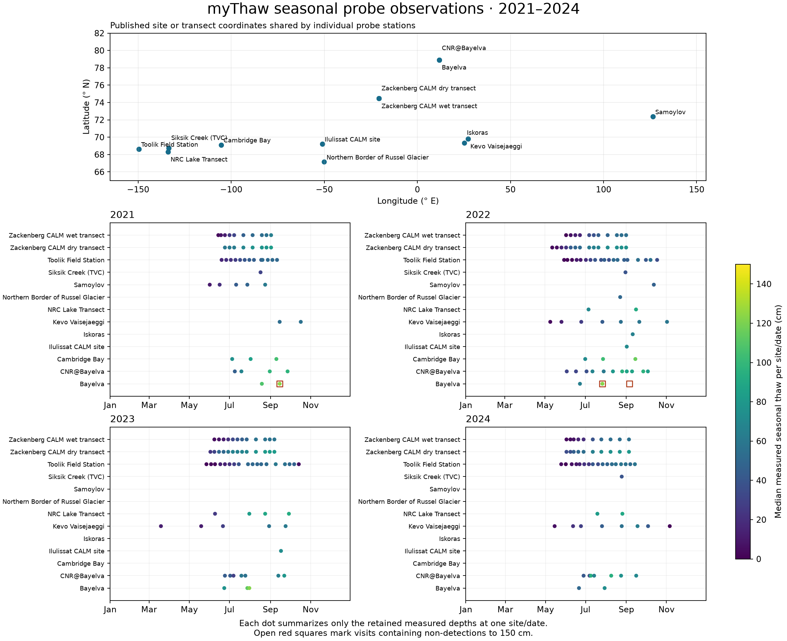

# myThaw seasonal probe observations

[Issue #44](https://github.com/jonschwenk/cusp/issues/44).
Release clearance is `needs_review`.

The [myThaw collection](https://doi.pangaea.de/10.1594/PANGAEA.971787)
contains four public annual releases. The
[2021](https://doi.pangaea.de/10.1594/PANGAEA.956039),
[2022](https://doi.pangaea.de/10.1594/PANGAEA.971586),
[2023](https://doi.pangaea.de/10.1594/PANGAEA.974461), and
[2024](https://doi.pangaea.de/10.1594/PANGAEA.997035) child records each
carry CC BY 4.0. The 2024 record was published on November 9, 2026 and is
publicly downloadable. These files were retrieved on November 24, 2026.
The archive preserves the original UTF-8 text exports and their attribution.

The [2022 protocol document](https://download.pangaea.de/reference/127187/attachments/Pangaea_METADATA_TMOSAiC_2022_myThaw.pdf)
describes thaw depth as the ground-surface-to-frost-table distance measured
with a steel rod. Its field-note table resolves the point-specific rock note
for protocol 1989470. The
[2024 document](https://download.pangaea.de/reference/141406/attachments/MyThaw_2024_Metadata_document.pdf)
documents the sites, method and nominal 1–1.5 m rod length.

Run from the repository root:

```powershell
python data/MyThaw_2026/process_mythaw_2026.py
python data/MyThaw_2026/plot_ingestion_review.py
python -m pytest tests/test_mythaw_2026.py -q
```

The processor is offline and verifies each annual export's SHA-256 before
reading it. It writes an audit row for each of the 11,423 raw rows, including
records collected for parameters other than thaw depth.

| Year | Raw rows | Measured seasonal thaw | Non-detections to 150 cm | Retained |
| --- | ---: | ---: | ---: | ---: |
| 2021 | 1,824 | 902 | 7 | 909 |
| 2022 | 3,655 | 1,326 | 14 | 1,340 |
| 2023 | 2,867 | 1,096 | 0 | 1,096 |
| 2024 | 3,077 | 1,054 | 0 | 1,054 |
| Total | 11,423 | 4,378 | 21 | 4,399 |

The retained records cover 13 named sites in Alaska, Canada, Greenland,
Svalbard, Finland, Norway and the Lena Delta. Numeric measured thaw depths
span 1–149 cm. Keep every survey date and point ID. The measurements sample
the seasonal thaw front, and `pf_depth` remains blank. Permafrost presence for
these measurements follows the documented permafrost monitoring context and
carries `PA`. Twenty-one source-described rod-limited measurements become
`pf_observed = 0`, `obs_limit = 150` and `LB`, with blank canonical depths.

## Exclusions and field interpretation

| Audit decision | Rows | Evidence |
| --- | ---: | --- |
| No thaw value | 6,467 | Empty depth, often a different parameter |
| Unresolved zero | 492 | Numeric zero cannot establish a depth or a positive non-detection limit |
| Copied protocols | 29 | Full raw records agree except protocol ID and measurement-day image |
| Stone stop | 9 | Specific source notes identify likely rocks or recommend discarding |
| Uncertain probe limit | 4 | Bayelva 2023 points 0, 1, 3, 7 may exceed the rod's reach |
| Surface refreezing | 18 | Notes state surface ice or frost over unfrozen soil |
| Questionable probing | 3 | Bayelva 2024 points 0–2 may have been over-hammered |
| Rod-length conflict | 1 | Bayelva's 182 cm single reading exceeds the stated nominal rod length |
| Pond ice reference | 1 | A reported numeric value is tied to a location beneath pond ice |

The 182 cm value is preserved in the audit pending confirmation of a longer
rod or the measurement interpretation. The 2023 note assigns points 0–3 to
July 28 and points 4–11 to July 31. Three early points are excluded for
uncertain depth, and the remaining retained point uses July 28 with its
original timestamp preserved. Statements about other points being completely
thawed leave those unmeasured points unresolved because no limit is supplied.

The copied protocols are 3253009 from 3231467, 3253004 from 3253000, and
4846957 from 4846950. Comparisons cover complete raw row vectors apart from
protocol and image identifiers. Source point IDs, dates, errors and depths
agree. The processor fails if those agreements change.

## Coordinates and overlap

Site IDs combine the named site, transect and source point ID.
Published transect coordinates locate all points at a common coordinate,
flagged `CS`. The 2022 transect fields have whole-degree precision. The
processor uses that year's precise site-description coordinate fields and
preserves both raw representations. These positions support regional
location and provenance. Individual station GPS positions are unavailable.

CALM has annual summaries for monitoring programmes shared with myThaw at
Toolik, Zackenberg and Samoylov. The 2,910 retained records at these sites
carry `DO`. Annual assigned September dates and grid means cannot identify
copies of individual seasonal points. All dated seasonal observations are
retained, with programme-level dependence documented.

The ALLena comparison uses native CUSP source `Veremeeva_etal_2025`. It
finds 31 Samoylov candidates in 2021 and 14 in 2022 within 1 km of the
myThaw site. None has a date shared by the retained myThaw visits. The
[overlap audit](overlap_review.csv) records the candidate counts and zero
deletions. Spatial proximity alone does not establish repeated publication.

## Spatial review



The map uses every distinct retained site or transect coordinate.
The depth panels use one median per site/date for measured seasonal depths,
with units in centimetres. Open red squares identify visits with 150 cm
non-detections, which contribute no measured depth to the median.
The [exact plotted data](review_plot_data.csv) includes measured and bounded
counts for every site/date. The [map code](plot_ingestion_review.py) regenerates
the panels from the unaggregated processed file.
