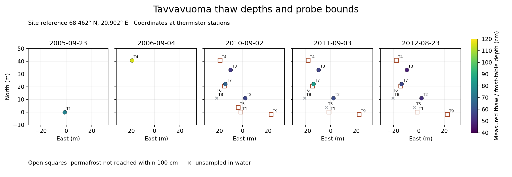

# Tavvavuoma peatland observations

Prepared for [issue #45](https://github.com/jonschwenk/cusp/issues/45).
Clearance remains `needs_review`.

The [Bolin Centre version 1 dataset](https://doi.org/10.17043/sannel-2020-temperature-1)
is CC BY 4.0. The checked workbook is an unchanged member of the provider's
sannel-2020.zip archive. The processor checks its SHA-256 and reads the original
worksheet XML using Python's standard library.

Run from the repository root.

```powershell
python data/Sannel_2020/process_sannel_2020.py
python data/Sannel_2020/plot_ingestion_review.py
```

The workbook has 27 station/date cells in the thaw worksheet. Nine contain
source-reported means with the three individual probe readings in parentheses.
Thirteen explicitly report >100 cm. Five say No data (in water).
The footnotes add two installation measurements, giving 29 audited candidates
and 24 retained records.

The retained records comprise 11 detections (47–115 cm) and 13 bounded
non-detections to 100 cm. Each non-detection has blank depth fields and
`obs_limit = 100`, with `LB`. A 100 cm probe can miss deeper permafrost,
including at the thermally monitored T4 station.
Nine means carry `SS`. Their rounded source values and individual readings
are preserved without adding the replicates as extra observations.

Station coordinates are converted from degrees and decimal minutes and repeated
for measurements within 25 cm of the cable (`CS`). The datum is unspecified,
so the WGS84 interpretation carries `CF`.
The exact source campaign dates are September 2, 2010, September 3, 2011,
and August 23, 2012. Footnotes specify T1 on September 23, 2005 (75 cm) and
T4 on September 4, 2006 (115 cm). The paper discussion associates T4 installation
with 2005. The T4 date follows the workbook and carries `DS` pending maintainer
review of that discrepancy.

The observations are late-season thaw depths. The methods paper explains that
the regional maximum thaw depth occurs later. The processed-source screen
found no existing CUSP rows within 4 km. All repeated dates are retained.



The map uses the complete [audit table](processing_audit.csv). Each date has its
own panel, with no spatial or temporal aggregation. Open squares indicate the
100 cm observation limit, and gray crosses mark unsampled water cells.
The [plot script](plot_ingestion_review.py) reproduces the figure.
