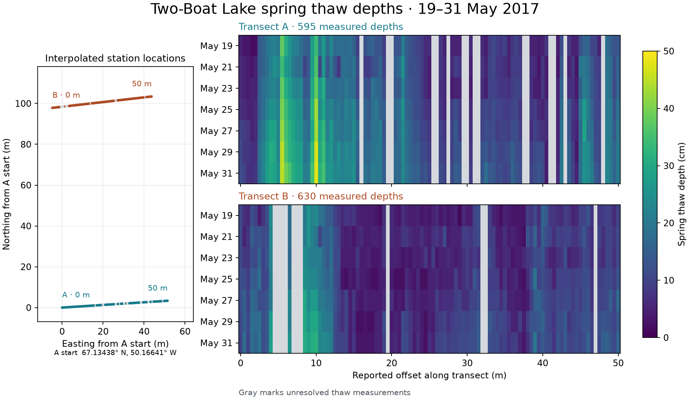

# Two-Boat Lake spring thaw depths

[Tracking issue #47](https://github.com/jonschwenk/cusp/issues/47).
Release clearance is `needs_review`.

## Source and reproduction

Sjöberg, Rydberg, and Lindborg (2026), *Thaw depth measurements along transects
A and B near Kangerlussuaq, West Greenland (May 2017)*. Both PANGAEA datasets
are [CC BY 4.0](https://creativecommons.org/licenses/by/4.0/).
The archive `pangaea_transects.zip` contains unchanged copies of the tab-delimited
exports retrieved on 2026-11-16 for [transect A](https://doi.pangaea.de/10.1594/PANGAEA.989941)
and [transect B](https://doi.pangaea.de/10.1594/PANGAEA.989942).
The processor checks each member's SHA-256. The member files include the original
dataset citations, event endpoints and variable documentation.

```powershell
python data/Sjoberg_2026_Two_Boat_Lake/process_sjoberg_2026_two_boat_lake.py
python data/Sjoberg_2026_Two_Boat_Lake/plot_ingestion_review.py
```

## Observation accounting

| Transect | Raw rows | Retained depths | Blank thaw depths | Rows with water values | Water values with blank thaw |
| --- | ---: | ---: | ---: | ---: | ---: |
| A | 707 | 595 | 112 | 193 | 8 |
| B | 707 | 630 | 77 | 182 | 17 |
| Total | 1,414 | 1,225 | 189 | 375 | 25 |

All retained values are steel-rod measurements of the spring thaw front,
ranging from 1 to 48 cm. The same 85 stations on A and 90 on B have numeric
depths on each of the seven rounds. The archive dates are May 19–31, 2017
at two-day intervals. The [methods paper](https://tc.copernicus.org/articles/20/47/2026/)
describes a monitoring period beginning May 18. The processor uses the dated
rows in the archive.

The terrestrial catchment is documented as underlain by continuous permafrost.
The processor records that contextual presence with `pf_observed = 1` and
flags it `PA` because the probe measured the spring thaw front. It sets
`method = tp` and leaves `pf_depth` and `obs_limit` blank. These values describe
seasonal thaw during snowmelt. The release schema calls the field `thaw_depth`.
The [audit](processing_audit.csv) preserves all blank attempts and water readings.
The archive gives rock refusal as a common reason for blank thaw depths but
does not identify a reason or numeric probe limit for individual rows.

## Locations and overlap

Both transects have 101 nominal offsets at 0.5 m spacing from 0 to 50 m.
The companion workbook listed on the PANGAEA pages confirms the start and end
coordinates but provides no intermediate station positions. The WGS84
endpoint spans are 51.73 m (A) and 48.90 m (B). The processor places a station
at its nominal offset divided by 50 m along the corresponding endpoint
geodesic. Every row carries the `CI` flag. Use source offsets for distances
along the transect. The interpolated positions supply approximate geographic
locations and have finer stored precision than their field accuracy.

The processed-source screen found only `Petrone_etal_2016` within 500 m of
the transect-area midpoint (67.13485° N, 50.16590° W). Geodesic distances from
the reconstructed positions to the nearest Petrone steel-rod measurements
are about 4 m for A and 2 m for B. The corresponding nearest GPR distances
are about 2 m and under 1 m. The interpolated geometry limits the spatial
interpretation of these distances.
Its 76 probe and 590 GPR observations belong to the August 2011 campaign.
The May 2017 probes measure a separate set of field visits. All dated
observations in both sources are retained.

## Spatial review



The [plot script](plot_ingestion_review.py) uses the audit table. The map shows
each station once in metres east and north of the start of A. The depth panels
show all seven dates on a common centimetre scale. Gray stations and cells
represent unresolved thaw measurements.
