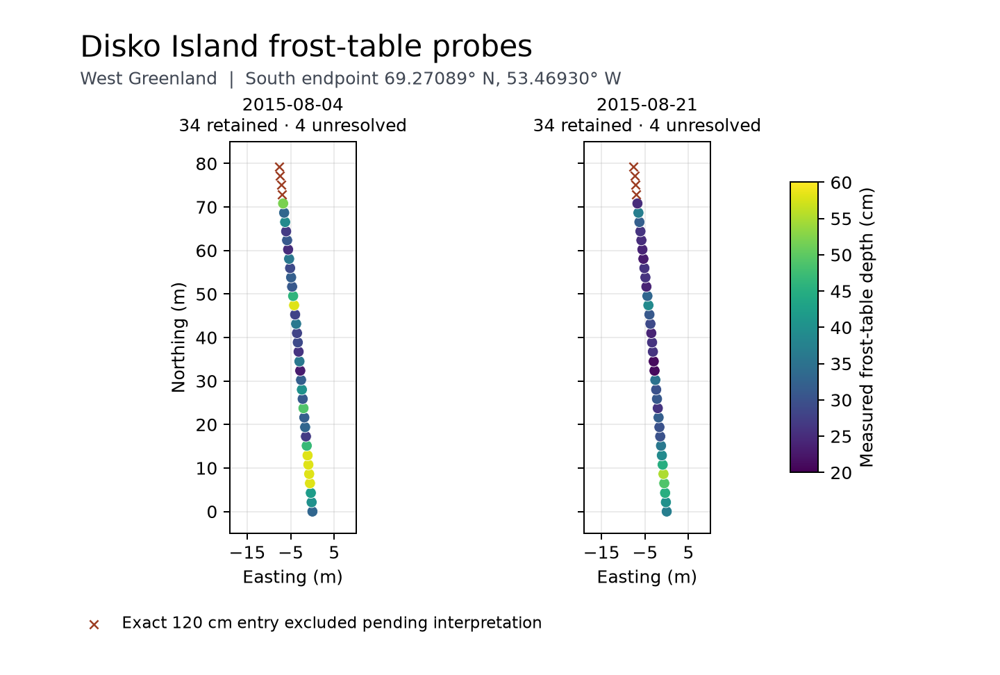

# Disko Island frost-table probes

[Tracking issue #46](https://github.com/jonschwenk/cusp/issues/46).
Release clearance is `needs_review`.

## Source and reproduction

Zastruzny, Elberling, Jensen, Sjöberg, and Liu (2024), *Field data from Disko
Island for thermal-hydrological investigations*. PANGAEA publishes the
[dataset](https://doi.pangaea.de/10.1594/PANGAEA.967139) under
[CC BY 4.0](https://creativecommons.org/licenses/by/4.0/). This ingestion uses
the steel-rod frost-table measurements from the [field study](https://doi.org/10.1029/2023WR036147).

Run from the repository root:

```powershell
python data/Zastruzny_2024/process_zastruzny_2024.py
python data/Zastruzny_2024/plot_ingestion_review.py
```

The checked-in [input](Disko2015_frost_table.tab) preserves the source strings
and order for the event label, longitude, latitude, timestamp, and frost-table
depth. To verify the subset against the full 36,973,301-byte text export
retrieved on 2026-11-16, download the [tab-delimited file](https://doi.pangaea.de/10.1594/PANGAEA.967139?format=textfile)
and pass its path with `--upstream` to the processor. The processor checks
both SHA-256 values and verifies that all rows carrying a frost-table depth are
represented in the event subset.

## Observation accounting

The full export contains 450,538 data rows. Of these, 450,462 fall outside the
frost-table event and have empty frost-table depth cells. The event contains
visits to the same 38 GPS positions on 4 and 21 August 2015.

| Decision | Aug 4 | Aug 21 | Total |
| --- | ---: | ---: | ---: |
| Retained direct detections | 34 | 34 | 68 |
| Held for interpretation at 120 cm | 4 | 4 | 8 |

Retained values span 21–58 cm. At this monitored permafrost site the late-summer
frost-table measurement supports both `thaw_depth` and `pf_depth`. Each
retained row has method `tp`, `pf_observed = 1`, and an empty `obs_limit`.
The processor preserves reported decimal-degree GPS coordinates and the upstream
timestamp. It assigns stable position IDs in south-to-north order.

All eight exact-120-cm values recur at the same four northern positions. An
[earlier report from this campaign](https://doi.org/10.5194/tc-2017-97) documents
thaw deeper than 120 cm at the site. The archive gives no row-level qualifier
for these values. They remain in the [audit](processing_audit.csv) pending
confirmation of whether they represent a probe limit or an exact detection.

The local processed-source screen found only CALM G3 within 4 km. G3's annual
records are about 2.65 km away and date to 1997–2000. All point and date pairs
in this event are unique. The processor retains both dates at each accepted
location without applying spatial aggregation.

## Spatial review



The [plot script](plot_ingestion_review.py) reads the [audit table](processing_audit.csv).
Each panel uses the same depth scale and a local metric approximation from the
southernmost GPS point. Crosses mark the four positions per day with unresolved
120 cm entries. Color shows measured frost-table depth in centimetres for the
68 retained observations.
